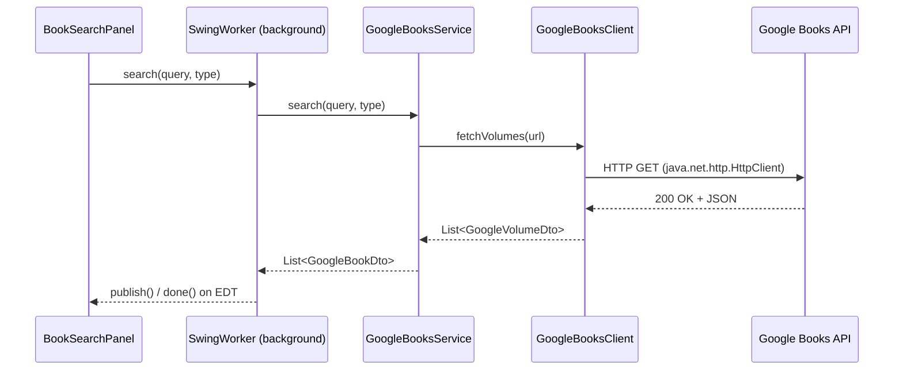

# LibraX — Google Books API Integration

## 1. Overview

LibraX integrates with the public **Google Books API**
(`https://www.googleapis.com/books/v1/volumes`) to let librarians discover
and import book metadata instead of typing it manually. This is the
**only** feature that requires internet access.

## 2. Endpoint Structure

```
GET https://www.googleapis.com/books/v1/volumes?q={query}&maxResults={n}&key={apiKey?}
```

Query construction by search type (built in `GoogleBooksClient`):

| Search type | Query fragment |
|---|---|
| ISBN | `isbn:{isbn}` |
| Title | `intitle:{title}` |
| Author | `inauthor:{author}` |
| Keyword | raw text |

An API key is **optional** for the public Books API at low volume; if
configured, it is supplied via `ApiConfig` (see §8), never hardcoded.

## 3. Request Flow



## 4. Response Mapping

Google's raw response is deserialized with Jackson into internal DTOs that
mirror only the fields LibraX needs — the rest of Google's payload is
ignored:

```
GoogleVolumesResponseDto
└── items: List<GoogleVolumeDto>
      ├── volumeInfo.title
      ├── volumeInfo.subtitle
      ├── volumeInfo.authors: List<String>
      ├── volumeInfo.publisher
      ├── volumeInfo.publishedDate
      ├── volumeInfo.description
      ├── volumeInfo.pageCount
      ├── volumeInfo.categories: List<String>
      ├── volumeInfo.imageLinks.thumbnail
      └── volumeInfo.industryIdentifiers: List<{type, identifier}>
```

`GoogleBooksService` flattens `GoogleVolumeDto` → `GoogleBookDto`
(a simpler, UI-friendly shape) before returning results, and never returns
raw Jackson trees to the UI.

## 5. DTOs

- `GoogleVolumeDto` — near-1:1 mirror of the Google JSON shape used only
  inside `api`/`dto` for deserialization.
- `GoogleBookDto` — the flattened shape the UI and import mapper consume
  (title, subtitle, authorNames, publisher, publishedDate, description,
  isbn, pageCount, category, thumbnailUrl).

Repository/service code that persists an imported book **only ever sees**
`GoogleBookDto` mapped into the domain `Book` model by
`BookService.importFromGoogleBooks(GoogleBookDto)` — DTOs never leak into
`repository`.

## 6. Error Handling

| Condition | Handling |
|---|---|
| No internet | `HttpConnectTimeoutException`/`IOException` caught → `ApiException("No internet connection")`; UI shows *"Unable to connect to Google Books. Please check your internet connection."* |
| Request timeout | `HttpClient` configured with a connect + request timeout → `ApiException("Request timed out")` |
| HTTP 429 (rate limit) | Detected by status code → `ApiException("Google Books rate limit reached, try again shortly")` |
| Invalid/unexpected JSON | Jackson `JsonProcessingException` caught → `ApiException("Received an unexpected response from Google Books")` |
| Missing fields in a result | Mapper fills sensible defaults (`"Unknown"`, `null` cover, empty description) rather than failing the whole search |
| Invalid ISBN entered by user | Validated client-side (`ValidationUtils.isValidIsbn`) before the request is even sent |
| Non-2xx, non-429 HTTP status | `ApiException("Google Books returned an error")`, technical status/body logged at `WARN` |

All `ApiException`s are caught at the `SwingWorker.done()` boundary; the
user sees a friendly, specific message while `GoogleBooksService` logs the
technical exception via SLF4J. **The rest of the application keeps working
normally** when the API is unavailable — this integration never blocks
core offline functionality.

## 7. Retry Strategy

A single lightweight retry (one retry, short backoff) is applied only for
**transient network failures** (connection reset/timeout), not for 4xx
client errors or JSON parsing failures, to avoid masking real problems
behind repeated calls.

## 8. Offline Behavior

- The Google Books search panel detects failures and shows a clear
  "offline" state with a retry action; it never throws an unhandled
  exception to the rest of the app.
- All non-API features (catalog browsing, issue/return, fines, reports,
  dashboard) work with zero network access.

## 9. Import Workflow

1. User searches (ISBN/title/author/keyword) → results rendered as cards.
2. User clicks **Import to Library** on a result.
3. `GoogleBookDto` → mapped to a `Book` (ISBN normalized, missing fields
   defaulted, `total_copies`/`available_copies` initialized to a
   user-specified count).
4. `BookService.createBook(...)` runs the same validation as a manually
   entered book (duplicate ISBN check, required fields) before persisting.
5. Success/failure is reported via the same friendly-error mechanism as
   manual entry — importing does not bypass validation.

## 10. Credentials & Configuration

- Endpoint base URL and (optional) API key live in
  `application.properties` / environment variables, read by
  `config.ApiConfig` — never hardcoded in source.
- No credentials are committed to Git (`.gitignore` excludes local
  override property files).
