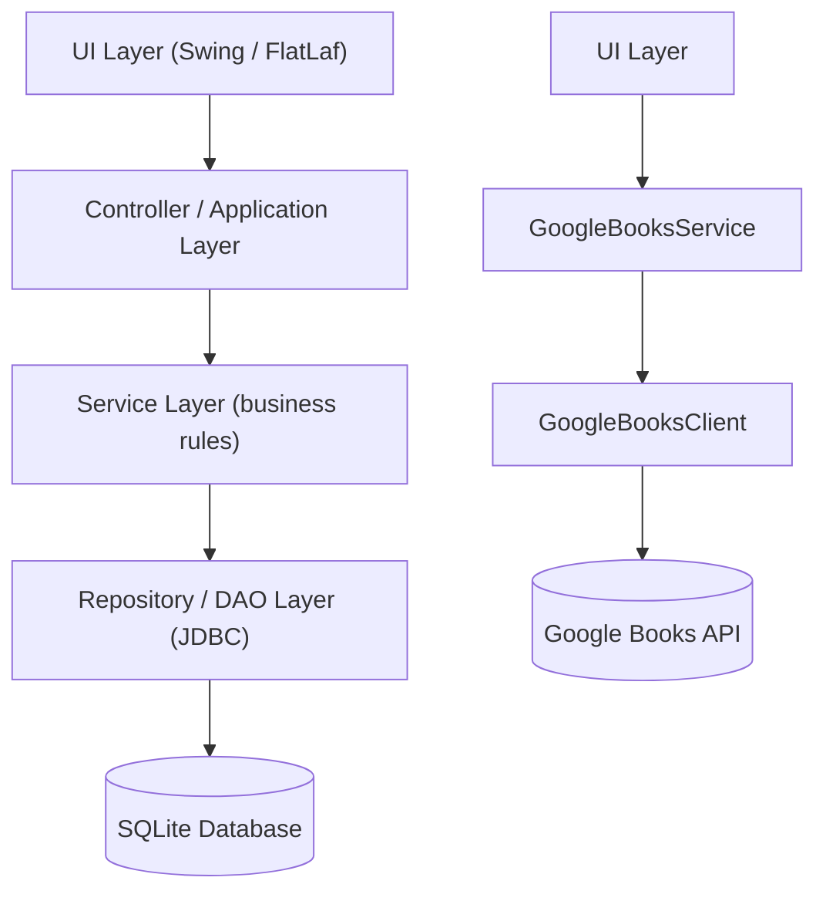
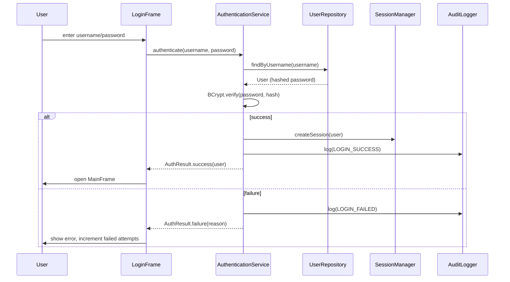
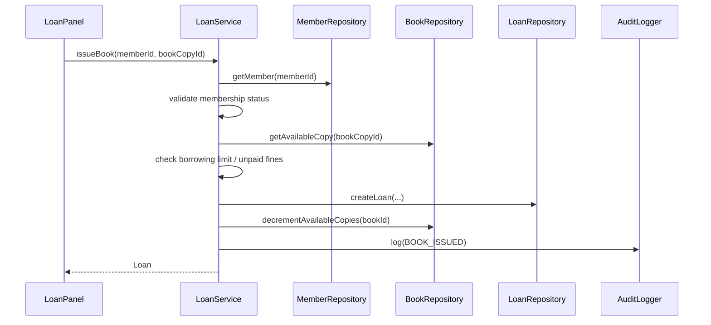
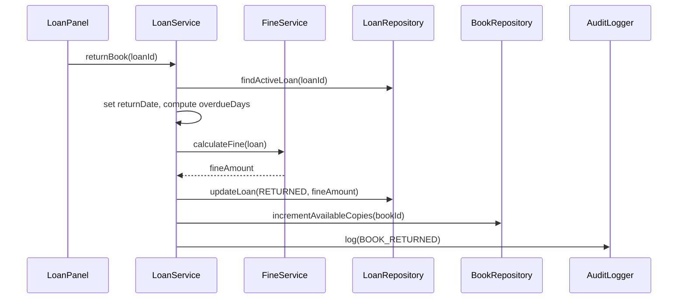
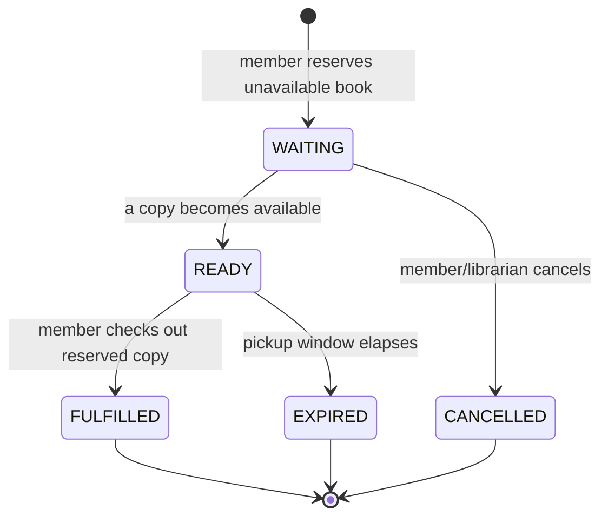
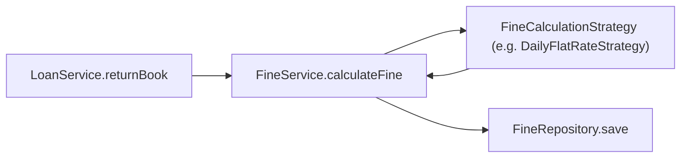
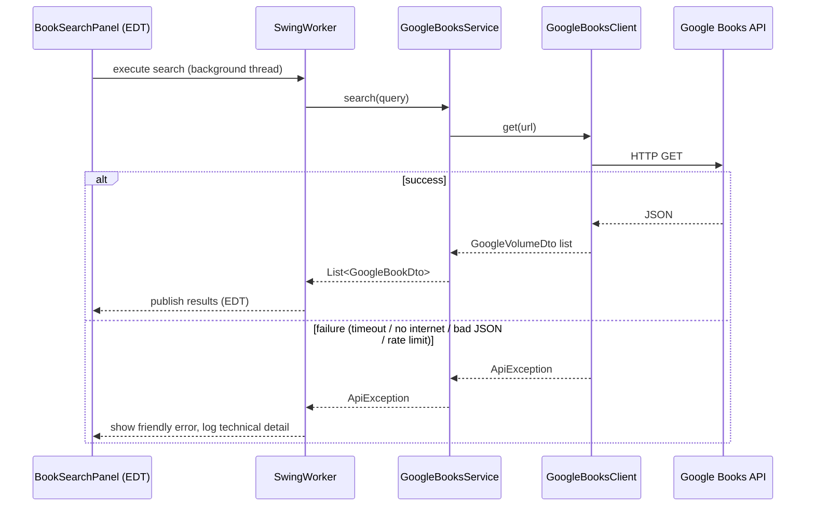

# LibraX — Architecture

## 1. System Architecture

LibraX follows a strict **layered architecture**. Each layer only depends on
the layer directly beneath it, and never on layers above it. UI code never
touches JDBC directly, and repositories never know about Swing.



## 2. Layer Responsibilities

| Layer | Responsibility | May depend on |
|---|---|---|
| `ui` | Swing components, event wiring, presentation only | `service`, `dto`, `model` (read-only display) |
| `service` | Business rules, validation orchestration, transactions | `repository`, `exception`, `model`, `security` |
| `repository` (+ `repository.impl`) | SQL access via `PreparedStatement`, mapping `ResultSet` → `model` | JDBC, `config` |
| `api` | Google Books HTTP client + mapping to internal `dto`/`model` | Jackson, `dto` |
| `model` | Core domain entities (records/classes) | none |
| `dto` | External API response shapes, decoupled from `model` | none |
| `security` | Password hashing, session management | `model` |
| `exception` | Custom exception hierarchy | none |
| `util` | Stateless helpers (validation, date formatting, dialogs) | none |
| `logging` | Audit trail writer | `repository`, `model` |
| `config` | Centralized configuration loading | none |

**Rule:** Business logic never lives in UI classes. SQL never lives outside
`repository.impl`. UI classes call `service` methods only.

## 3. Package Structure

```
com.librax
├── App.java                      Application entry point
├── config/                       AppConfig, DatabaseConfig, ApiConfig
├── model/                        Domain entities (User, Book, Loan, ...)
├── dto/                          Google Books DTOs
├── repository/                   Repository interfaces
├── repository/impl/              JDBC implementations
├── service/                      Business/application services
├── api/                          GoogleBooksClient, GoogleBooksService
├── ui/                           MainFrame, LoginFrame, feature panels
│   ├── components/               Reusable Swing widgets
│   ├── dashboard/ books/ members/ loans/ reservations/ fines/ reports/ settings/
├── security/                     PasswordHasher, SessionManager
├── exception/                    Custom exception hierarchy
├── util/                         ValidationUtils, DateUtils, DialogUtils
└── logging/                      AuditLogger
```

## 4. Data Flow — Authentication



## 5. Data Flow — Book Issue



## 6. Data Flow — Book Return



## 7. Data Flow — Reservation



## 8. Fine Calculation Flow

`FineService` delegates the actual math to a `FineCalculationStrategy`
(Strategy pattern), so alternate fine schemes can be swapped without
touching `LoanService` or the UI:



## 9. Google Books API Flow



Import maps a selected `GoogleBookDto` into a `Book` entity and persists it
through `BookService`/`BookRepository` — the API layer never touches SQLite
directly, and the repository layer never sees Google DTOs.

## 10. Database Architecture

SQLite accessed exclusively through `PreparedStatement` via a
`DatabaseManager` connection/DataSource abstraction. Foreign-key enforcement
is enabled (`PRAGMA foreign_keys = ON`) on every connection. Full schema in
[DATABASE.md](DATABASE.md).

## 11. Security Architecture

- Passwords hashed with BCrypt (never stored/logged in plaintext).
- All queries use `PreparedStatement`; no string concatenation with user input.
- Role-based authorization enforced at the service layer (not just hidden in UI).
- `SessionManager` tracks the current authenticated user/role and logout.
- Every sensitive action writes an `audit_logs` row via `AuditLogger`.
- No secrets committed to Git — see `.gitignore` and [API.md](API.md).

## 12. Error Handling

Custom exception hierarchy under `com.librax.exception`:

```
LibraXException (RuntimeException)
├── DatabaseException
├── ValidationException
├── AuthenticationException
├── BookNotAvailableException
└── ApiException
```

Exceptions are never swallowed. Services log technical detail via SLF4J and
throw a typed exception; UI code catches the typed exception and shows a
friendly `JOptionPane`/dialog message.

## 13. Concurrency Model

- Swing EDT is reserved for UI updates only.
- Google Books API calls, CSV/PDF report generation, and heavy analytics
  queries run on `SwingWorker` background threads (or an `ExecutorService`
  for non-UI-triggered work).
- Shared mutable state (e.g. `SessionManager`) is kept minimal and
  thread-safe.

## 14. Design Patterns in Use

| Pattern | Where | Why |
|---|---|---|
| Repository | `repository` / `repository.impl` | Decouple persistence from business logic |
| Service Layer | `service` | Centralize business rules & transactions |
| DTO | `dto` | Isolate external API shape from domain model |
| Strategy | `service.FineCalculationStrategy` | Swappable fine-calculation algorithms |
| Factory | `repository` construction, `PasswordHasher` | Encapsulate object creation |
| Singleton (justified) | `DatabaseManager`, `AppConfig` | Single shared connection pool / config source |
| Constructor Dependency Injection | Throughout | Testability (Mockito), no hidden `new` in business logic |
| MVC/MVP-inspired | `ui` + `service` | Panels are passive views; services hold logic |

## 15. Technology Decisions

| Decision | Rationale |
|---|---|
| SQLite over a client-server DB | Zero-install offline-first desktop app |
| FlatLaf over default Swing L&F | Modern look without leaving the JDK/Swing ecosystem |
| Jackson over manual JSON parsing | Robust, well-tested mapping with `jackson-datatype-jsr310` for `java.time` |
| BCrypt over SHA-256 | Adaptive, salted, purpose-built for password hashing |
| SLF4J + Logback | Industry-standard logging facade + implementation |
| Maven Shade plugin | Produces a single runnable jar for easy grading/demo |
