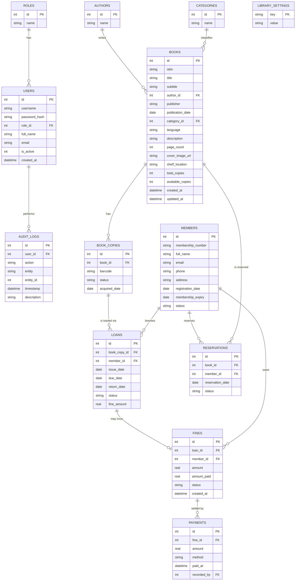

# LibraX — Database Design

SQLite, normalized to 3NF, foreign keys enforced (`PRAGMA foreign_keys = ON`).
Full DDL will be delivered in `src/main/resources/db/schema.sql` in **Phase 2**;
this document defines the target schema that phase will implement.

## 1. ER Diagram

## 2. Table Reference

### `roles`
| Column | Type | Constraints |
|---|---|---|
| id | INTEGER | PK, AUTOINCREMENT |
| name | TEXT | NOT NULL, UNIQUE (`ADMIN`, `LIBRARIAN`) |

### `users`
| Column | Type | Constraints |
|---|---|---|
| id | INTEGER | PK, AUTOINCREMENT |
| username | TEXT | NOT NULL, UNIQUE |
| password_hash | TEXT | NOT NULL (BCrypt) |
| role_id | INTEGER | NOT NULL, FK → roles(id) |
| full_name | TEXT | NOT NULL |
| email | TEXT | UNIQUE |
| is_active | INTEGER | NOT NULL DEFAULT 1, CHECK(is_active IN (0,1)) |
| failed_login_attempts | INTEGER | NOT NULL DEFAULT 0 |
| created_at | TEXT (ISO-8601) | NOT NULL |

### `members`
| Column | Type | Constraints |
|---|---|---|
| id | INTEGER | PK, AUTOINCREMENT |
| membership_number | TEXT | NOT NULL, UNIQUE |
| full_name | TEXT | NOT NULL |
| email | TEXT | NOT NULL, UNIQUE |
| phone | TEXT | NOT NULL |
| address | TEXT | |
| registration_date | TEXT | NOT NULL |
| membership_expiry | TEXT | NOT NULL |
| status | TEXT | NOT NULL, CHECK(status IN ('ACTIVE','EXPIRED','SUSPENDED')) |

### `authors`
| id INTEGER PK | name TEXT NOT NULL UNIQUE |

### `categories`
| id INTEGER PK | name TEXT NOT NULL UNIQUE |

### `books`
| Column | Type | Constraints |
|---|---|---|
| id | INTEGER | PK, AUTOINCREMENT |
| isbn | TEXT | NOT NULL, UNIQUE |
| title | TEXT | NOT NULL |
| subtitle | TEXT | |
| author_id | INTEGER | FK → authors(id) |
| publisher | TEXT | |
| publication_date | TEXT | |
| category_id | INTEGER | FK → categories(id) |
| language | TEXT | |
| description | TEXT | |
| page_count | INTEGER | CHECK(page_count >= 0) |
| cover_image_url | TEXT | |
| shelf_location | TEXT | |
| total_copies | INTEGER | NOT NULL DEFAULT 0, CHECK(total_copies >= 0) |
| available_copies | INTEGER | NOT NULL DEFAULT 0, CHECK(available_copies >= 0) |
| created_at | TEXT | NOT NULL |
| updated_at | TEXT | NOT NULL |

Index: `idx_books_title`, `idx_books_isbn`, `idx_books_author`, `idx_books_category`.

### `book_copies`
| Column | Type | Constraints |
|---|---|---|
| id | INTEGER | PK, AUTOINCREMENT |
| book_id | INTEGER | NOT NULL, FK → books(id) ON DELETE CASCADE |
| barcode | TEXT | NOT NULL, UNIQUE |
| status | TEXT | NOT NULL, CHECK(status IN ('AVAILABLE','ISSUED','LOST','DAMAGED','RETIRED')) |
| acquired_date | TEXT | NOT NULL |

### `loans`
| Column | Type | Constraints |
|---|---|---|
| id | INTEGER | PK, AUTOINCREMENT |
| book_copy_id | INTEGER | NOT NULL, FK → book_copies(id) |
| member_id | INTEGER | NOT NULL, FK → members(id) |
| issue_date | TEXT | NOT NULL |
| due_date | TEXT | NOT NULL |
| return_date | TEXT | NULL |
| status | TEXT | NOT NULL, CHECK(status IN ('ACTIVE','RETURNED','OVERDUE','LOST')) |
| fine_amount | REAL | NOT NULL DEFAULT 0, CHECK(fine_amount >= 0) |

Index: `idx_loans_member`, `idx_loans_status`, `idx_loans_due_date`.

### `reservations`
| Column | Type | Constraints |
|---|---|---|
| id | INTEGER | PK, AUTOINCREMENT |
| book_id | INTEGER | NOT NULL, FK → books(id) |
| member_id | INTEGER | NOT NULL, FK → members(id) |
| reservation_date | TEXT | NOT NULL |
| status | TEXT | NOT NULL, CHECK(status IN ('WAITING','READY','FULFILLED','CANCELLED','EXPIRED')) |

### `fines`
| Column | Type | Constraints |
|---|---|---|
| id | INTEGER | PK, AUTOINCREMENT |
| loan_id | INTEGER | NOT NULL, FK → loans(id) |
| member_id | INTEGER | NOT NULL, FK → members(id) |
| amount | REAL | NOT NULL, CHECK(amount >= 0) |
| amount_paid | REAL | NOT NULL DEFAULT 0, CHECK(amount_paid >= 0) |
| status | TEXT | NOT NULL, CHECK(status IN ('OUTSTANDING','PARTIALLY_PAID','PAID','WAIVED')) |
| created_at | TEXT | NOT NULL |

### `payments`
| Column | Type | Constraints |
|---|---|---|
| id | INTEGER | PK, AUTOINCREMENT |
| fine_id | INTEGER | NOT NULL, FK → fines(id) |
| amount | REAL | NOT NULL, CHECK(amount > 0) |
| method | TEXT | NOT NULL, CHECK(method IN ('CASH','UPI','CARD','OTHER')) |
| paid_at | TEXT | NOT NULL |
| recorded_by | INTEGER | NOT NULL, FK → users(id) |

### `audit_logs`
| Column | Type | Constraints |
|---|---|---|
| id | INTEGER | PK, AUTOINCREMENT |
| user_id | INTEGER | FK → users(id) |
| action | TEXT | NOT NULL |
| entity | TEXT | NOT NULL |
| entity_id | INTEGER | |
| timestamp | TEXT | NOT NULL |
| description | TEXT | |

### `library_settings`
| Column | Type | Constraints |
|---|---|---|
| key | TEXT | PK |
| value | TEXT | NOT NULL |

## 3. Relationships Summary

- `users.role_id → roles.id` (many users per role)
- `books.author_id → authors.id`, `books.category_id → categories.id`
- `book_copies.book_id → books.id` (one book, many physical copies)
- `loans.book_copy_id → book_copies.id`, `loans.member_id → members.id`
- `reservations.book_id → books.id`, `reservations.member_id → members.id`
- `fines.loan_id → loans.id`, `fines.member_id → members.id`
- `payments.fine_id → fines.id`, `payments.recorded_by → users.id`
- `audit_logs.user_id → users.id`

## 4. Notes

- All dates/timestamps stored as ISO-8601 `TEXT` for portability and to
  work cleanly with `java.time` via manual parsing (SQLite has no native
  temporal type).
- `books.available_copies` is a derived/cached value kept in sync by
  `LoanService`/`BookService` inside the same transaction as the
  corresponding `book_copies.status` change, rather than recomputed via a
  `COUNT` on every read — chosen for dashboard query performance.
