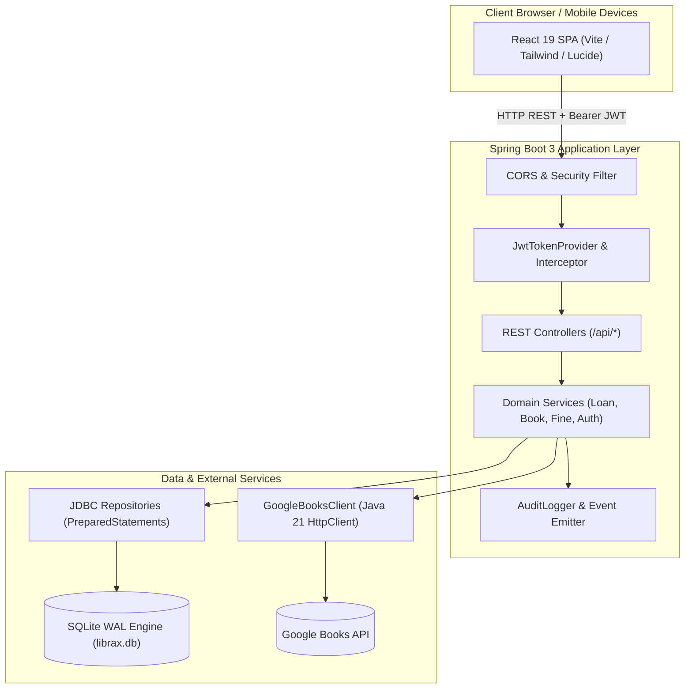
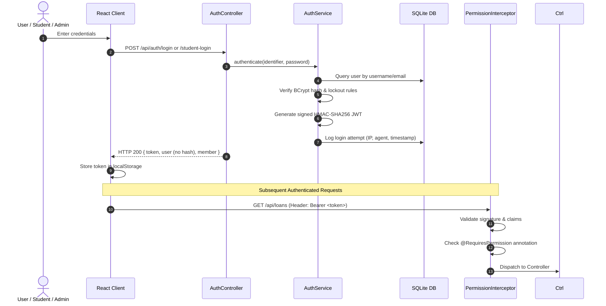

# LibraX — System Architecture Document

## 1. High-Level Architecture Overview

LibraX is architected as a modern, decoupled full-stack platform consisting of:
1. **Frontend Presentation Tier**: React 19 Single Page Application (SPA), styled with Tailwind CSS v4, Lucide vector icons, and Framer Motion micro-interactions.
2. **REST API & Application Tier**: Spring Boot 3.3.5 running on Java 21, managing authentication, Role-Based Access Control (RBAC), loan circulation policies, and audit trails.
3. **Data Persistence Tier**: Embedded SQLite relational engine running in Write-Ahead Logging (WAL) mode with strict foreign key constraints and automated schema migration.
4. **External Services Tier**: Non-blocking Java 21 `HttpClient` communicating asynchronously with the Google Books Volumes v1 API.

---

## 2. Layer Responsibilities & Boundaries

| Layer | Responsibility | Dependencies / Allowed Interactions |
| :--- | :--- | :--- |
| **`frontend/src`** | Component rendering, user interaction, UI routing, state management | Communicates solely via HTTP to `/api/*` endpoints |
| **`web`** | REST controllers, request parameter mapping, DTO validation, HTTP response wrapping | Calls `service` layer, checks `@RequiresPermission` |
| **`security`** | Password hashing (BCrypt), JWT creation/validation, ThreadLocal security context | `model`, `repository` |
| **`service`** | Core business logic, transaction boundaries, circulation rule enforcement | `repository`, `model`, `logging`, `config` |
| **`repository`** | Data access layer, SQL execution via parameterized `PreparedStatement`, entity row mapping | `DatabaseManager`, JDBC |
| **`api`** | External HTTP client integration (Google Books Volumes v1) | `HttpClient`, Jackson JSON, `config` |
| **`model`** | Domain entity definitions (User, Book, Member, Loan, Fine, Reservation) | Standalone POJOs |
| **`config`** | Central configuration (`application.properties`), SQLite DDL initialization, bean wiring | Spring Core |

---

## 3. Authentication & Authorization Flow

---

## 4. Design System Tokens & Aesthetics
- **Color Space**: Neutral slate/zinc foundation paired with academic amber/gold accents (`#F59E0B`) and emerald financial indicators.
- **Theme Support**: Real-time CSS variable toggling between Light (Alabaster) and Dark (Charcoal/Zinc).
- **Component Primitives**: Adapted from modern 21st.dev specifications (GlassCard, Bento Grid, Floating AI Librarian, Interactive Data Tables, Badge status indicators).
