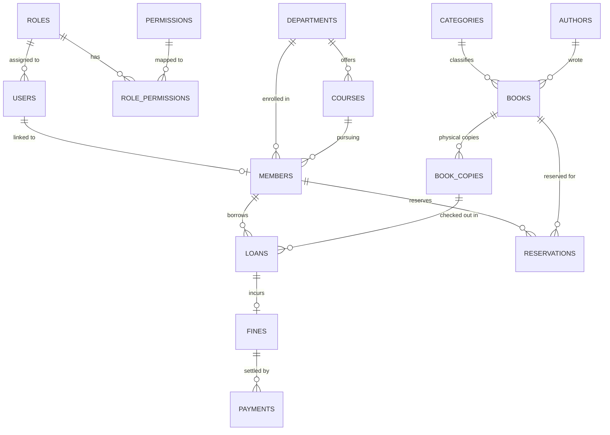

# LibraX — Relational Database Architecture

## 1. Schema Overview

LibraX utilizes an embedded SQLite database (`librax.db`) structured across **13 relational tables**. The engine operates in Write-Ahead Logging (`WAL`) mode with foreign key constraints actively enforced (`PRAGMA foreign_keys = ON;`).

---

## 2. Relational Table Specifications

### 1. `roles`
System access tiers.
- `id`: INTEGER PRIMARY KEY AUTOINCREMENT
- `name`: TEXT NOT NULL UNIQUE (`SUPER_ADMIN`, `ADMIN`, `LIBRARIAN`, `STUDENT`)

### 2. `permissions`
Granular functional rights.
- `id`: INTEGER PRIMARY KEY AUTOINCREMENT
- `name`: TEXT NOT NULL UNIQUE (e.g. `BOOK_VIEW`, `BOOK_CREATE`, `BOOK_IMPORT`, `LOAN_CREATE`, `LOAN_RENEW`, `FINE_PAYMENT`)
- `category`: TEXT NOT NULL (`CATALOG`, `CIRCULATION`, `STUDENTS`, `FINANCE`, `SECURITY`)
- `description`: TEXT

### 3. `role_permissions`
Cross-reference mapping roles to authorized permissions.
- `role_id`: INTEGER REFERENCES roles(id)
- `permission_id`: INTEGER REFERENCES permissions(id)
- PRIMARY KEY (`role_id`, `permission_id`)

### 4. `users`
System accounts with credentials and lockout state.
- `id`: INTEGER PRIMARY KEY AUTOINCREMENT
- `username`: TEXT NOT NULL UNIQUE
- `password_hash`: TEXT NOT NULL (BCrypt cost 12 hash)
- `role_id`: INTEGER NOT NULL REFERENCES roles(id)
- `full_name`: TEXT NOT NULL
- `email`: TEXT UNIQUE
- `status`: TEXT NOT NULL DEFAULT 'ACTIVE' (`ACTIVE`, `SUSPENDED`, `LOCKED`, `DISABLED`)
- `failed_login_attempts`: INTEGER NOT NULL DEFAULT 0
- `locked_until`: TEXT (ISO timestamp if locked)
- `last_login`: TEXT
- `created_at`: TEXT NOT NULL

### 5. `departments` & `courses`
Academic affiliation structures for university students.
- `departments`: `id`, `name`, `code` (e.g. `CSE`, `IT`, `ECE`, `SOM`)
- `courses`: `id`, `department_id` REFERENCES departments(id), `name`, `code`

### 6. `members`
Library cardholder profiles.
- `id`: INTEGER PRIMARY KEY AUTOINCREMENT
- `user_id`: INTEGER REFERENCES users(id)
- `membership_number`: TEXT NOT NULL UNIQUE (`LIB-STU-XXXX`)
- `full_name`: TEXT NOT NULL
- `email`: TEXT NOT NULL UNIQUE
- `phone`: TEXT NOT NULL
- `address`: TEXT
- `department_id`: INTEGER REFERENCES departments(id)
- `course_id`: INTEGER REFERENCES courses(id)
- `registration_date`: TEXT NOT NULL
- `membership_expiry`: TEXT NOT NULL
- `status`: TEXT NOT NULL (`ACTIVE`, `EXPIRED`, `SUSPENDED`)

### 7. `authors` & `categories`
Catalog metadata entities.
- `authors`: `id`, `name` NOT NULL UNIQUE
- `categories`: `id`, `name` NOT NULL UNIQUE

### 8. `books`
Bibliographic master records.
- `id`: INTEGER PRIMARY KEY AUTOINCREMENT
- `isbn`: TEXT NOT NULL UNIQUE
- `title`: TEXT NOT NULL
- `subtitle`: TEXT
- `author_id`: INTEGER REFERENCES authors(id)
- `category_id`: INTEGER REFERENCES categories(id)
- `publisher`: TEXT
- `publication_date`: TEXT
- `language`: TEXT DEFAULT 'en'
- `description`: TEXT
- `page_count`: INTEGER
- `cover_image_url`: TEXT
- `shelf_location`: TEXT
- `total_copies`: INTEGER NOT NULL DEFAULT 1
- `available_copies`: INTEGER NOT NULL DEFAULT 1

### 9. `book_copies`
Physical library assets with barcode tags and condition ratings.
- `id`: INTEGER PRIMARY KEY AUTOINCREMENT
- `book_id`: INTEGER NOT NULL REFERENCES books(id)
- `barcode`: TEXT NOT NULL UNIQUE
- `status`: TEXT NOT NULL (`AVAILABLE`, `LOANED`, `LOST`, `DAMAGED`)
- `condition`: TEXT NOT NULL DEFAULT 'GOOD'
- `shelf`: TEXT

### 10. `loans`
Circulation checkout records.
- `id`: INTEGER PRIMARY KEY AUTOINCREMENT
- `book_copy_id`: INTEGER NOT NULL REFERENCES book_copies(id)
- `member_id`: INTEGER NOT NULL REFERENCES members(id)
- `issue_date`: TEXT NOT NULL
- `due_date`: TEXT NOT NULL
- `return_date`: TEXT
- `fine_amount`: DECIMAL(10,2) DEFAULT 0.00
- `status`: TEXT NOT NULL (`ACTIVE`, `RETURNED`, `OVERDUE`)

### 11. `reservations`
Book hold queue.
- `id`: INTEGER PRIMARY KEY AUTOINCREMENT
- `book_id`: INTEGER NOT NULL REFERENCES books(id)
- `member_id`: INTEGER NOT NULL REFERENCES members(id)
- `reservation_date`: TEXT NOT NULL
- `status`: TEXT NOT NULL (`WAITING`, `READY`, `FULFILLED`, `CANCELLED`)

### 12. `fines`
Financial assessments for overdue materials.
- `id`: INTEGER PRIMARY KEY AUTOINCREMENT
- `loan_id`: INTEGER REFERENCES loans(id)
- `member_id`: INTEGER NOT NULL REFERENCES members(id)
- `amount`: DECIMAL(10,2) NOT NULL
- `reason`: TEXT
- `issue_date`: TEXT NOT NULL
- `paid_date`: TEXT
- `status`: TEXT NOT NULL (`PENDING`, `PAID`, `WAIVED`)

### 13. `payments`
Cashier receipts with audit references.
- `id`: INTEGER PRIMARY KEY AUTOINCREMENT
- `fine_id`: INTEGER NOT NULL REFERENCES fines(id)
- `student_id`: INTEGER REFERENCES members(id)
- `amount`: DECIMAL(10,2) NOT NULL
- `payment_method`: TEXT NOT NULL (`CASH`, `CARD`, `UPI`, `ONLINE`)
- `reference`: TEXT NOT NULL UNIQUE
- `payment_date`: TEXT NOT NULL
- `notes`: TEXT

---

## 3. Database Indexes for Query Optimization
- `idx_users_username` on `users(username)`
- `idx_users_email` on `users(email)`
- `idx_books_isbn` on `books(isbn)`
- `idx_books_title` on `books(title)`
- `idx_loans_member_id` on `loans(member_id)`
- `idx_loans_status` on `loans(status)`
- `idx_fines_member_id` on `fines(member_id)`
- `idx_fines_status` on `fines(status)`
